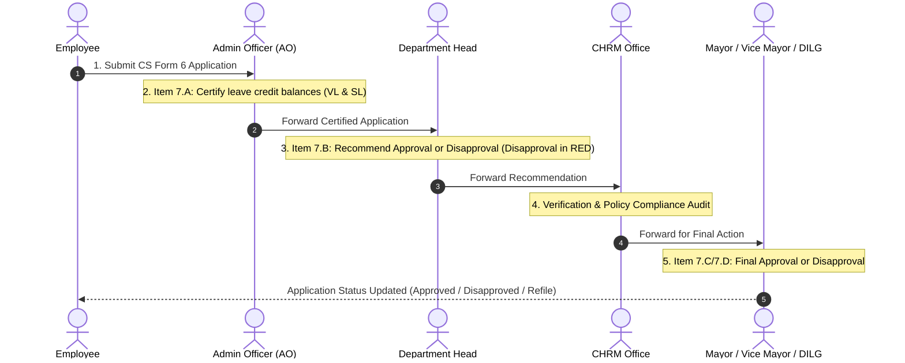
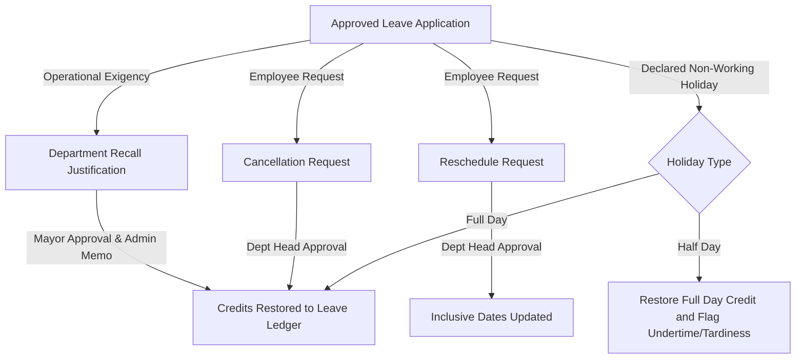

# CGB-HRMS Phase 3: Leave Management System Specification
## Polished & Enhanced Gathered Data Document

> **Document ID:** CGB-HRMS-PHASE3-GATHERED-DATA-V2  
> **Target System:** City Government of Butuan Human Resource Management System (CGB-HRMS)  
> **Module Scope:** Phase 3 – Leave Management & Compensatory Time-Off  
> **Source Basis:** Gathered Data (October 15, 2026), High-Level System Flow v5, CSC Omnibus Rules on Leave (Rule XVI, E.O. 292 / CSC MC No. 41, s. 1998 as amended), CSC Resolution No. 2100020 (Expanded Maternity Leave), CSC-DBM Joint Circular No. 1, s. 2006 (COC/CTO), CGB Administrative Procedure Manual (CGB.PR.035.REV02), and Official Document Templates.

---

## 1. Executive Summary & Architecture Overview

The Leave Management Module (Phase 3) automates, regulates, and audits the entire leave administration lifecycle for all personnel of the City Government of Butuan (CGB). The system enforces strict compliance with Civil Service Commission (CSC) rules and Department of Budget and Management (DBM) joint issuances, while accommodating operational realities such as delegated signatories, post-approval recall/cancellations, holiday adjustments, and downstream personnel impact (Notice of Step Increment, Service Record, and AWOL alerts).

### High-Level System Flow Architecture (v5)

```mermaid
flowchart TD
    Root["1. LEAVE MANAGEMENT"]

    Root --> M1["1.1 Employee Leave Credits"]
    Root --> M2["1.2 Leave Applications"]
    Root --> M3["1.3 Leave Data Management"]
    Root --> M4["1.4 Reports"]

    %% 1.1 Branch
    M1 --> M1_1["1.1.1 Different Types of Leave"]
    M1_1 --> M1_1_1["1.1.1.1 View Instructions & Requirements per Leave Type"]
    M1 --> M1_2["1.1.2 Actual Leave Credits (Single Pane View)"]
    M1_2 --> M1_2_1["1.1.2.1 Basic & Mandatory (VL, SL, FL)"]
    M1_2 --> M1_2_2["1.1.2.2 Special Privileges & Family (SLP, ML, PL, SPL)"]
    M1_2 --> M1_2_3["1.1.2.3 Special Emergency & Statutory (SEL, Rehab, Magna Carta, VAWC, Study)"]
    M1_2 --> M1_2_4["1.1.2.4 Compensatory Time-Off (CTO) & Time Offset (TO)"]
    M1_2 --> M1_2_5["1.1.2.5 Creation/Modification of Leave Crediting"]
    M1_2_5 --> M1_2_5_1["1.1.2.5.1 Manual vs. Automated Granting"]

    %% 1.2 Branch
    M2 --> M2_1["1.2.1 Employee Leave Applications"]
    M2_1 --> M2_1_1["1.2.1.1 View Leave Application Details"]
    M2 --> M2_2["1.2.2 Creation of Leave Application (Inc. Monetization & TLB)"]
    M2_2 --> M2_2_1["1.2.2.1 Input Details (CS Form 6 Mapping)"]
    M2_2 --> M2_2_2["1.2.2.2 Compliance & Approval (5-Tier Chain)"]
    M2 --> M2_3["1.2.3 Modification of Approved Leave"]
    M2_3 --> M2_3_1["1.2.3.1 Request & Admin Approval (Dept Head + HR Admin)"]

    %% 1.3 Branch
    M3 --> M3_1["1.3.1 Employee Leave Credits Management"]
    M3 --> M3_2["1.3.2 Employee Leave Ledger Management (Employee: View | AO: View | HR: CRUD)"]
    M3 --> M3_3["1.3.3 COC & Earned Time-Off (ETO) Ledger Management"]

    %% 1.4 Branch
    M4 --> M4_1["1.4.1 Regulatory Compliance Reports (MRATU, SRATU)"]
    M4 --> M4_2["1.4.2 Official Certifications (Earned Credits, CETO)"]
    M4 --> M4_3["1.4.3 Operational Schedules (Work Schedule Master, DTR Rectification)"]
```



---

## 2. Personnel Dual-Track Scope

To reflect legal constraints and CGB template structures, the system strictly isolates two personnel tracks:

| Dimension             | Track A: Government Service Personnel (CSC Track)                                                           | Track B: Non-Government Service Personnel (COS/JO Track)                                                     |
| :-------------------- | :---------------------------------------------------------------------------------------------------------- | :----------------------------------------------------------------------------------------------------------- |
| **Coverage**          | Plantilla Regular, Temporary, Casual, Contractual employees.                                                | Contract of Service (COS), Job Order (JO) personnel.                                                         |
| **Governing Rules**   | CSC Omnibus Rules on Leave (Rule XVI, EO 292 / CSC MC No. 41, s. 1998, as amended); CSC Res. 2100020.       | COA-DBM Joint Circular No. 2, s. 2020; CGB Local Policy.                                                     |
| **Accrual Mechanism** | Cumulative accrual of Vacation Leave (VL) and Sick Leave (SL) at **1.25 days per month** of actual service. | **No statutory leave credits.** Personnel earn time credits strictly via approved overtime hours.            |
| **Application Form**  | **Civil Service Form No. 6 (Revised 2020)** + CS Form No. 6a.                                               | **Time Offset Application** (`forms__time-offset-application.docx`).                                         |
| **Overtime / Offset** | **Compensatory Overtime Credits (COC)** & **Compensatory Time-Off (CTO)** under CSC-DBM JC No. 1, s. 2006.  | **Overtime Request Form** (`forms__overtime-request-form.docx`) & **Certificate of Earned Time-Off (CETO)**. |
| **Ledger System**     | **Employee Leave Ledger Card** (`reports__leave-ledger.xlsx`).                                              | **Earned Time-Off Ledger** (`reports__earned-time-off-ledger.docx`).                                         |

---

## 3. Subsystem 1.1: Employee Leave Credits

### 1.1.1 Different Types of Leave & 1.1.1.1 Instructions/Requirements

All leave types defined in CS Form No. 6 (Item 6.A and 6.B) and relevant special laws are cataloged in the system. The portal provides employees and Administrative Officers (AO) with interactive guidelines, filing windows, and required attachments:

| Leave Type                                         | Legal Basis                            | Allocation / Entitlement                                                                                                        | Filing Window                                                                                                                    | Required Documentary Attachments                                                                    | Accrual / Deductibility                                                                        |
| :------------------------------------------------- | :------------------------------------- | :------------------------------------------------------------------------------------------------------------------------------ | :------------------------------------------------------------------------------------------------------------------------------- | :-------------------------------------------------------------------------------------------------- | :--------------------------------------------------------------------------------------------- |
| **Vacation Leave (VL)**                            | Sec. 51, Rule XVI, EO 292              | Accrues at $1.25\text{ days/month}$ ($15\text{ days/year}$)                                                                     | At least 5 days in advance                                                                                                       | None for local travel; Travel Authority for travel abroad                                           | Accrues; deductible from VL balance                                                            |
| **Mandatory / Forced Leave (FL)**                  | Sec. 25, Rule XVI, EO 292              | 5 days annually (mandatory if employee has $\ge 10\text{ days}$ VL)                                                             | Pre-scheduled annual plan                                                                                                        | Annual Leave Schedule                                                                               | Deducted from VL balance; forfeited if unused unless cancelled/recalled                        |
| **Sick Leave (SL)**                                | Sec. 43, Rule XVI, EO 292              | Accrues at $1.25\text{ days/month}$ ($15\text{ days/year}$)                                                                     | Immediately upon return to duty or can be advanced or during leave of absence with supporting documents such as doctor's advice. | CS Form 6; Medical Certificate if illness exceeds 5 successive days or for hospital/outpatient care | Accrues; deductible from SL balance. (Late filing flagged if filed past return period)         |
| **Maternity Leave (ML)**                           | R.A. 11210 / CSC Res. 2100020          | **105 days** (live birth); **120 days** (solo mother); **60 days** (miscarriage / emergency termination). Optional 30 days LWOP | At least 30 days prior, except emergency                                                                                         | Medical Certificate; Proof of pregnancy; CS Form 6a if allocating up to 7 days                      | Non-deductible from VL/SL; earns leave credits during period                                   |
| **Paternity Leave (PL)**                           | R.A. 8187 / CSC MC 71, s. 1998         | **7 working days** for married male employees (first 4 deliveries)                                                              | In advance or within reasonable time                                                                                             | Proof of marriage (Marriage Contract) and birth of child (Birth Certificate/Medical proof)          | Non-deductible; non-cumulative; non-commutative                                                |
| **Special Privilege Leave (SLP)**                  | Sec. 21, Rule XVI, EO 292              | **3 days annually** (milestone, mourning, graduation, hospital, domestic emergency)                                             | At least 1 week in advance, except emergencies                                                                                   | Written reason / event proof                                                                        | Non-cumulative; non-commutative; not deducted from VL/SL                                       |
| **Solo Parent Leave (SPL)**                        | R.A. 8972 / CSC MC 8, s. 2004          | **7 working days annually**                                                                                                     | At least 5 days in advance                                                                                                       | Valid Solo Parent Identification Card                                                               | Non-cumulative; requires annual Solo Parent ID renewal                                         |
| **Study Leave**                                    | Sec. 68, Rule XVI, EO 292              | Up to **6 months** (Master's completion / Board / BAR Exam review)                                                              | At least 3 months prior to period                                                                                                | Contract/Agreement; School certification; Approval of Mayor                                         | Subject to service obligation contract; approved by Agency Head                                |
| **10-Day VAWC Leave**                              | R.A. 9262 / CSC Res. 051206            | **10 days annually** for female employees victims of violence                                                                   | Immediately or in advance                                                                                                        | Protection Order (BPO, TPO, PPO), Police Report, or Barangay Certification                          | Paid leave; non-deductible from VL/SL; extendible if needed                                    |
| **Rehabilitation Privilege**                       | Sec. 55, Rule XVI, EO 292              | Up to **6 months** for job-related injuries / wounds                                                                            | Within 1 week of injury occurrence                                                                                               | Police/Incident Report, Medical Certificate, Recommendation of AO/Dept Head                         | Full salary; **does NOT earn VL/SL credits** during period                                     |
| **Special Leave Benefits for Women (Magna Carta)** | R.A. 9710 / CSC MC 25, s. 2010         | Up to **2 months** full pay post-gynecological surgery                                                                          | At least 30 days in advance (elective) or post-op                                                                                | Medical Certificate, Clinical Summary, Operative Record, Histopath Report                           | Full salary; requires $\ge 6\text{ months}$ aggregate service; **does NOT earn VL/SL credits** |
| **Special Emergency (Calamity) Leave (SEL)**       | CSC MC 16, s. 2012 / CSC MC 2, s. 2012 | Up to **5 days** per natural disaster / calamity                                                                                | Within 30 days from calamity occurrence                                                                                          | Barangay / LGU Calamity Declaration or proof of residence in declared calamity zone                 | Non-deductible from VL/SL; granted per disaster event                                          |
| **Adoption Leave**                                 | R.A. 8552 / CSC Res. 2100020           | **60 continuous days** (child under 7 years old)                                                                                | Prior to placement                                                                                                               | DSWD Pre-Adoption Placement Authority (PAPA)                                                        | With full pay; non-deductible from VL/SL                                                       |
| **Monetization of Leave Credits**                  | Sec. 22–23, Rule XVI; DBM BC 2016-2    | Minimum 10 days; up to 50% or more upon valid justification                                                                     | During annual monetization window                                                                                                | Letter of Request; Medical/Emergency proof if $>50\%$                                               | Deducted from VL/SL balances (SL only monetized if VL exhausted)                               |
| **Terminal Leave Benefit (TLB)**                   | Sec. 35, Rule XVI; DBM BC 2016-2       | Commutation of all accumulated VL and SL credits                                                                                | Upon retirement, resignation, separation                                                                                         | Clearance Form, Service Record, Separation Order                                                    | Full monetary value commuted; earns no leave credits                                           |

### 1.1.2 Actual Leave Credits & Single Pane View

The system provides a consolidated dashboard for each employee displaying:
1. **Accrued Balances**: Vacation Leave Balance, Sick Leave Balance.
2. **Fixed Annual Entitlements**: Forced Leave (Balance / Used / Forfeited), Special Privilege Leave (3 days balance), Solo Parent Leave (7 days balance).
3. **Compensatory Balances**: Compensatory Overtime Credits (COC/CTO) in hours/days.
4. **Non-Government Time Credits**: Earned Time-Off (ETO) balance for COS/JO personnel.

### 1.1.2.5 Creation/Modification of Leave Crediting Engine

The crediting engine handles two modes of crediting:
- **Manual Form / Admin Trigger (1.1.2.5.1)**:
  - *Special Emergency (Calamity) Leave*: When the City Mayor or Sangguniang Panlungsod / NDRRMC declares a state of calamity, the HR Admin triggers batch crediting of 5 days SEL to employees residing in affected zones.
- **Automated Form / System Trigger (1.1.2.5.1)**:
  - *Standard Monthly Accrual*: On the last day of each calendar month, the system credits $1.25\text{ VL}$ and $1.25\text{ SL}$ to all active plantilla/casual employees, adjusted automatically for any Leave Without Pay (LWOP) incurred in that month.
  - *Approved Lifecycle Crediting*: For conditional statutory leaves (Maternity Leave, Paternity Leave, Magna Carta for Women, Adoption Leave), upon final approval of the application by the City Mayor / Vice Mayor, the system automatically validates and credits the allocated entitlement into the active leave window.

---

## 4. Subsystem 1.2: Leave Applications

### 1.2.1 & 1.2.2 Creation & Input Details (CS Form No. 6 Mapping)

The application workflow directly corresponds to Civil Service Form No. 6 (Revised 2020):

```
CS Form No. 6 Sections:
├── 1. Office / Department
├── 2. Name (Last, First, Middle)
├── 3. Date of Filing
├── 4. Position & 5. Salary
├── 6. Details of Application
│   ├── 6.A Type of Leave to be Availed Of
│   ├── 6.B Details of Leave (Specific conditions, destinations, illnesses)
│   ├── 6.C Number of Working Days Applied For & Inclusive Dates
│   └── 6.D Commutation Selection:
│       ├── "Not Requested" (Standard typical leave applications)
│       └── "Requested" (For Leave Monetization & Terminal Leave Benefit)
└── 7. Details of Action on Application
    ├── 7.A Certification of Leave Credits (Admin Officer)
    ├── 7.B Recommendation (Department Head - Disapproval rendered in RED font)
    ├── 7.C Approved For: (Days with pay, days without pay, others)
    └── 7.D Disapproved Due To: (Reason stated by Approving Authority)
```

#### Late Filing Logic & UI Watermarking
- **Sick Leave Filing Rule**: Sick leave must be filed immediately upon the employee's return from illness, with a maximum filing window of **five (5) days after the affected days of leave**.
- **Automated Flag**: If an employee files a sick leave application where the date of filing exceeds **5 days after the inclusive dates**, the application is automatically flagged as **Late Filing**.
- **UI Treatment**: The system applies an explicit **"LATE FILING" watermark** beneath the inclusive dates/input field and on the generated CS Form No. 6, and logs the flag into the audit trail and leave ledger card (rendered in **RED FONT**).

### 1.2.2.2 Approval Chain & Signatory Routing Matrix

The system implements a rigid 5-tier review and approval lifecycle:



#### Routing Table by Branch & Appointment:

| Applicant Hierarchy | Certified By (Item 7.A) | Recommended By (Item 7.B) | Approving Authority (Item 7.C/7.D) |
| :--- | :--- | :--- | :--- |
| **Executive Branch (Rank & File)** | Department AO | Department Head | **City Mayor** |
| **Executive Branch (Department Heads)** | CHRMO Head / AO | CHRMO Head / City Administrator | **City Mayor** |
| **Legislative Branch (SP Rank & File)** | SP Admin Officer | Secretary to the Sangguniang Panlungsod | **City Vice Mayor** |
| **Legislative Branch (SP Dept Heads/Sec)** | CHRMO Head / AO | Secretary to the Sangguniang Panlungsod | **City Vice Mayor** |
| **City Vice Mayor** | CHRMO Head | City Administrator (Noted) | **City Mayor** |
| **City Mayor** | CHRMO Head | City Administrator (Noted) | **DILG Regional Director / Secretary** |

#### Delegated / Alternating Signatory Feature
- When the City Mayor or City Vice Mayor is traveling, on official leave, or incapacitation, the system allows the HR Admin to activate an **Alternate Signatory (e.g., Acting Mayor / Vice Mayor / Officer-in-Charge via Office Order)**.
- **Revocation Rule**: Operates strictly under **manual revocation** by the HR Admin (the alternate signatory delegation remains active in all routing queues until the HR Admin manually deactivates it upon the principal official's official resumption of duty).
- The generated PDF/printout dynamically displays: *"For: [Official Name], [Title] by [Designated OIC], [Designation Order No.]"*.

### 1.2.3 Modification of Approved Leave

Once an application is approved, any modification must follow a dedicated administrative sub-process:



#### 1. Recall & Restoration Flow (VL & FL Only)
1. **Trigger**: Emergency operational exigency requires the presence of an employee already on approved Vacation or Forced Leave.
2. **Recommendation**: Department Head submits a Recall Request specifying the operational reason.
3. **Approval**: Transmitted to the **City Mayor** for formal approval.
4. **Documentation**: An official **Administrative Recall Memo** is generated by the system.
5. **Ledger Action**: Unused/recalled leave credits are restored to the employee's Leave Ledger card with the notation: *"Recalled per Memo No. [XXXX]"*.

#### 2. Cancellation Process Flow (Advance Filing & Sick Leave)
1. **Trigger**: Employee cancels an advance-filed leave or unused approved leave.
2. **Request**: Employee submits cancellation request via portal before or during the leave period.
3. **Approval**: Approved directly by the **Department Head**.
4. **Ledger Action**: System restores the deducted leave credits to the active leave ledger.

#### 3. Rescheduling Process Flow (Advance Filing & Sick Leave)
1. **Trigger**: Employee requests shifting approved dates to a future window.
2. **Approval**: Approved directly by the **Department Head**.
3. **Ledger Action**: Inclusive dates updated; leave ledger balance remains bracketed.

#### 4. Automatic Holiday Collision & Restoration Rule
- **Full-Day Declared Holiday**: If a non-working holiday is declared during an employee's approved leave, the system automatically cancels the leave deduction for that day and restores 1.0 day of leave credit to the ledger.
- **Half-Day Declared Holiday**:
  - The system **restores the entire 1.0 day equivalent** of leave credit to the employee's ledger.
  - The system automatically flags the employee's attendance record with **undertime or tardiness** corresponding to the half-day working session that was not covered by the holiday.

---

## 5. Subsystem 1.3: Leave Data Management & Mathematical Engine

### 1.3.1, 1.3.2, 1.3.3 Role-Based Access Control (RBAC) Matrix

| System Data Domain | Employee | Admin Officer (Department) | HR Admin (CHRMO) |
| :--- | :---: | :---: | :---: |
| **Personal Leave Balances (1.1.2)** | **View** | **View (Dept Scope)** | **CRUD (All)** |
| **Leave Applications (1.2.1)** | **Create / View Own** | **View / Certify (Dept Scope)** | **CRUD (All)** |
| **Employee Leave Ledger Card (1.3.2)** | **View** | **View (Dept Scope)** | **CRUD (All / Full Override)** |
| **COC & Earned Time-Off (ETO) Ledger (1.3.3)** | **View** | **View (Dept Scope)** | **CRUD (All)** |
| **System Settings & Holiday Calendar** | No Access | No Access | **CRUD** |

### Mathematical Computation Engine (CSC Omnibus Rules Tables I–IV)

#### 1. Standard Monthly Accrual (Table I)
Employees earn $1.25\text{ days}$ of Vacation Leave and $1.25\text{ days}$ of Sick Leave for each full month of actual service:
$$\text{Annual Entitlement} = 15\text{ days VL} + 15\text{ days SL} = 30\text{ days total}$$

#### 2. Daily Pro-Rated Accrual for Partial Months (Table II)
For employees who enter or leave government service mid-month, accrual is calculated as $\text{Days Present} \div 24$:

$$\text{Credits Earned} = \text{round}\left(\frac{\text{Days of Actual Service}}{24}, 3\right)$$

*Selected Daily Conversion Factors:*
- $1\text{ day} = 0.042$ | $6\text{ days} = 0.250$ | $12\text{ days} = 0.500$
- $18\text{ days} = 0.750$ | $24\text{ days} = 1.000$ | $30\text{ days} = 1.250$

#### 3. Proportionate Accrual in Months with Leave Without Pay (Table III)
When an employee incurs Leave Without Pay (LWOP), monthly accrual is reduced proportionately based on the number of days present:

$$\text{Monthly Accrual} = \frac{\text{Days Present}}{30} \times 1.25$$

> **Critical CGB Business Rule**: The reduction in earned leave credits resulting from LWOP **only affects the Vacation Leave (VL) credit accrual**, leaving the Sick Leave accrual unaffected unless explicitly required by medical unfitness.

*Table III Step Scale:*
- $30.0\text{ days present (0 LWOP)} = 1.250\text{ credits}$
- $25.0\text{ days present (5 LWOP)} = 1.042\text{ credits}$
- $20.0\text{ days present (10 LWOP)} = 0.833\text{ credits}$
- $15.0\text{ days present (15 LWOP)} = 0.625\text{ credits}$
- $10.0\text{ days present (20 LWOP)} = 0.417\text{ credits}$
- $5.0\text{ days present (25 LWOP)} = 0.208\text{ credits}$
- $0.0\text{ days present (30 LWOP)} = 0.000\text{ credits}$

#### 4. Tardiness and Undertime Conversion (Table IV)
- Working day basis: $8\text{ hours} = 480\text{ minutes} = 1.0\text{ day}$
- Hour conversion: $1\text{ hour} = \frac{1}{8} = 0.125\text{ day}$
- Minute conversion: $1\text{ minute} = \frac{0.125}{60} = 0.00208333...\text{ day}$

$$\text{Leave Deduction} = (\text{Hours} \times 0.125) + (\text{Minutes} \times 0.002083)$$

*Charging Hierarchy:*
- Tardiness and undertime are **strictly deducted from Vacation Leave (VL)** credits.
- Tardiness and undertime **can never be charged against Sick Leave (SL)** unless the undertime was due to medical illness verified by a medical certificate.
- If VL balance reaches 0.000, any excess tardiness/undertime is converted to **Leave Without Pay (LWOP)**.
- In the Leave Ledger card, all late filing, tardiness, and undertime entries must be **highlighted in RED FONT**.

#### 5. Non-Earning Leaves with Pay
Under CSC rules, while employees are on approved paid leave for:
1. **Magna Carta for Women (R.A. 9710)** (Up to 2 months)
2. **Rehabilitation Privilege (Sec. 55)** (Up to 6 months)

They receive full pay, but **do not earn leave credits (VL/SL)** during the duration of their leave. The system automatically halts the monthly $1.25$ accrual during these periods.

---

## 6. Downstream Administrative Integrations

### 6.1 Notice of Step Increment (NOSI) Postponement
- **Governing Policy**: CSC-DBM Joint Circular on Step Increments based on Length of Service.
- **Rule**: If an employee incurs cumulative Leave Without Pay (LWOP) of **15 days or more** within the 3-year step increment qualification period, the effectivity date of the step increment is postponed.
- **Calculation Formula**:
  $$\text{Adjusted NOSI Date} = \text{Original NOSI Date} + \text{Total Days of LWOP}$$
- *Example*:
  - Original NOSI Effectivity: **January 15, 2026**
  - Accumulated LWOP Days: **30 days**
  - **Adjusted NOSI Effectivity**: **February 14, 2026**
- **System Action**: When updating the leave ledger with LWOP, the system recalculates and updates the employee's pending NOSI record and issues an alert to the HR Compensation & Benefits section.

### 6.2 Absence Without Official Leave (AWOL) & Dropping from the Rolls
- **Governing Policy**: CSC MC No. 13, s. 2007; Omnibus Rules Sec. 63.
- **Rule**: Continuous unauthorized absence without approved leave constitutes AWOL.
- **System Automated Alert**: If an employee accumulates **20 days of AWOL within a single calendar month** (or continuous 30 days without notice), the system immediately generates an automated high-priority notification to the **HR Admin**.
- **Action**: Generates a standard *Return-to-Work Order* / *Notice of Explanation*, initiating proceedings for dropping from the rolls.

### 6.3 Service Record Synchronization
- Every instance of approved leave resulting in **Leave Without Pay (LWOP)** must be automatically synced into the employee's official **Service Record**.
- Format: Inclusive dates of LWOP, total days, reason, and CSC notation (*"Without Pay"*).

### 6.4 Leave Monetization Restrictions
- **Minimum Monetization**: 10 days per year, provided the employee retains a minimum balance of 5 days VL.
- **Exhaustion Rule**: An employee **may only monetize Sick Leave (SL) credits if their Vacation Leave (VL) credits are already fully exhausted**, and with formal written authorization from the **City Mayor**.

---

## 7. Subsystem 1.4: Regulatory Reports, Forms & Document Templates

The system dynamically populates and exports all official CGB reports and CSC documents:

| Report / Form Name | Template Source | Frequency / Trigger | Recipient / Purpose |
| :--- | :--- | :--- | :--- |
| **Application for Leave (CS Form No. 6)** | `forms__application-for-leave-form.xlsx` | Per leave filing | Standard official CSC leave filing format with barcodes/digital signatures. |
| **Notice of Allocation of Maternity Leave (CS Form No. 6a)** | `forms__notice-of-allocation-of-maternity-leave.docx` | Filed with Maternity Leave | Formal notice allocating up to 7 days to father or alternate caregiver. |
| **Monthly Report on Absence, Tardiness & Undertime (MRATU)** | `reports__monthly-report-on-absence-tardiness-undertime-(MRATU).xlsx` | Monthly | Dual-sheet regulatory report: **Regular MRATU** & **Casual MRATU**. Feeds into payroll for deductions. |
| **Summary Report on Absences, Tardiness & Undertime (SRATU)** | `reports__summary-report-on-absences-tardiness-undertime-(SRATU).docx` | Monthly | Prepared by Dept AO, certified by Dept Head; transmitted to CHRMO. |
| **Employee's Leave Ledger Card** | `reports__leave-ledger.xlsx` | Continuous / On-demand | Official lifelong ledger tracking all VL/SL accruals, deductions, LWOP, and balances. |
| **Certificate of Earned Leave Credits** | `certificates__certificate-of-earned-leave.docx` | On-demand / Clearance | Formal certification signed by CHRMO certifying accumulated VL/SL balances for transfer/retirement. |
| **Certificate of Earned Time-Off (CETO)** | `certificates__certificate-of-earned-time-off-(CETO).docx` | Monthly / Per overtime project | Official certification for Non-Government Service Personnel (COS/JO) crediting earned offset hours. |
| **Earned Time-Off Ledger** | `reports__earned-time-off-ledger.docx` | Continuous | Offset ledger for COS/JO personnel tracking overtime credits and time offsets availed. |
| **Work Schedule Master** | `reports__work-schedule.xlsx` | Monthly / Quarterly | Official roster of departmental shifts, flexitime, and rotation schedules. |
| **DTR Rectification Form** | `forms__dtr-rectification-form.xlsx` | Exception trigger | Official rectification of missing biometric punches or device failure. |

---

## 8. Summary of Polish & Enhancements Applied

1. **System Flow Structural Realignment**: Every requirement, screen, and workflow is now mapped to nodes `1.1` through `1.4` of **Phase 3 High-Level System Flow v5**.
2. **Statutory Integrity**: Backed raw notes with exact legal citations from the Omnibus Rules, R.A. 11210, R.A. 9262, R.A. 9710, and CSC-DBM Joint Circulars.
3. **Personnel Track Clarity**: Clearly decoupled Civil Service personnel (Plantilla/Casual) from Non-Government Service personnel (COS/JO), specifying their distinct forms (CS Form 6 vs. CETO/Time Offset).
4. **Mathematical Precision**: Added full conversion formulas and step-tables for monthly accrual ($1.25$), partial month daily rates ($0.042$), LWOP proportional reduction, and tardiness/undertime conversion ($0.125/\text{hr}$, $0.002083/\text{min}$).
5. **Concrete LGU Edge Cases**: Explicitly formalized the red font recommendation rule, late-filing watermark, alternate signatory routing, recall memo generation, half-day holiday credit restoration with undertime flagging, 15-day NOSI postponement, and 20-day AWOL automated alerts.
