# CGB-HRMS Phase 3: System Flow Decomposition & Process Specifications

## Granular Breakdown of System Flow v5 & End-to-End Process Workflows

> **System:** City Government of Butuan Human Resource Management System (CGB-HRMS)  
> **Module Scope:** Phase 3 – Leave Management & Compensatory Time-Off  
> **Reference Model:** `Phase 3_ High-Level System Flow v5.png`  
> **Legal Baseline:** CSC Omnibus Rules on Leave (Rule XVI, E.O. 292 / CSC MC No. 41, s. 1998 as amended), CSC Res. 2100020 (Expanded Maternity Leave), CSC-DBM JC No. 1, s. 2006 (COC/CTO), COA-DBM JC No. 2, s. 2020 (COS/JO).

---

## 1. Complete Structural Decomposition of System Flow Boxes

The diagram below mirrors and expands every single box and leaf node identified in **Phase 3 High-Level System Flow v5**:

```mermaid
flowchart TD
    Root["1. LEAVE MANAGEMENT"]

    %% Tier 1
    Root --> M1["1.1 Employee Leave Credits"]
    Root --> M2["1.2 Leave Applications"]
    Root --> M3["1.3 Leave Data Management"]
    Root --> M4["1.4 Reports"]

    %% 1.1 Branch
    M1 --> B1_1["1.1.1 Different Types of Leave"]
    B1_1 --> B1_1_1["1.1.1.1 View Instructions & Requirements per Leave Type"]

    M1 --> B1_2["1.1.2 Actual Leave Credits (Single Pane View)"]
    B1_2 --> B1_2_1["1.1.2.1 Basic & Mandatory (VL, SL, FL)"]
    B1_2 --> B1_2_2["1.1.2.2 Special Privileges & Family (SLP, ML, PL, SPL)"]
    B1_2 --> B1_2_3["1.1.2.3 Special Emergency & Statutory (SEL, Rehab, Magna Carta, VAWC, Study)"]
    B1_2 --> B1_2_4["1.1.2.4 Compensatory Time-Off (CTO) & Time Offset (TO)"]
    B1_2 --> B1_2_5["1.1.2.5 Creation/Modification of Leave Crediting"]
    B1_2_5 --> B1_2_5_1["1.1.2.5.1 Manual vs. Automated Granting"]

    %% 1.2 Branch
    M2 --> B2_1["1.2.1 Employee Leave Applications"]
    B2_1 --> B2_1_1["1.2.1.1 View Leave Application Details"]
    M2 --> B2_2["1.2.2 Creation of Leave Application (Inc. Monetization & TLB)"]
    B2_2 --> B2_2_1["1.2.2.1 Input Details (CS Form 6 Mapping)"]
    B2_2 --> B2_2_2["1.2.2.2 Compliance & Approval (5-Tier Chain)"]
    M2 --> B2_3["1.2.3 Modification of Approved Leave"]
    B2_3 --> B2_3_1["1.2.3.1 Request & Admin Approval (Dept Head + HR Admin)"]

    %% 1.3 Branch
    M3 --> B3_1["1.3.1 Employee Leave Credits Management (HR Admin)"]
    M3 --> B3_2["1.3.2 Employee Leave Ledger Management (Employee: View | AO: View | HR: CRUD)"]
    M3 --> B3_3["1.3.3 COC & Earned Time-Off (ETO) Ledger Management (Employee: View | AO: View | HR: CRUD)"]

    %% 1.4 Branch
    M4 --> B4_1["1.4.1 Regulatory Compliance Reports (MRATU Regular/Casual, SRATU)"]
    M4 --> B4_2["1.4.2 Official Certifications (Earned Credits, CETO)"]
    M4 --> B4_3["1.4.3 Operational Schedules (Work Schedule Master, DTR Rectification)"]
```

---

## 2. Granular Box Breakdown & Specifications

### Box 1.1: Employee Leave Credits
Central repository and engine for tracking, presenting, and granting employee leave entitlements.

*   **Box 1.1.1: Different Types of Leave**
    *   **Scope:** Global catalog of statutory and administrative leaves recognized under Philippine Civil Service laws and local CGB policies.
    *   **Components:** 15 distinct leave categories (Vacation, Sick, Forced/Mandatory, Maternity, Paternity, Solo Parent, Special Privilege, Study, VAWC, Rehabilitation, Magna Carta for Women, Calamity/SEL, Adoption, Monetization, Terminal Leave).
    *   **Box 1.1.1.1: View Instructions & Requirements per Leave Type**
        *   **Role:** Employee Self-Service (ESS) and Administrative Officer (AO) reference modal.
        *   **Data Fields:** Legal citation, filing window requirements (e.g., 5 days advance for VL, within 30 days for Calamity), mandatory documentary attachments (e.g., Medical Certificate, Barangay Calamity Declaration, Solo Parent ID), pay status (with pay vs. without pay), and credit-earning rules.

*   **Box 1.1.2: Actual Leave Credits (Single Pane View)**
    *   **Scope:** Unified real-time dashboard displaying all leave credit balances for an individual employee.
    *   **Box 1.1.2.1: Basic & Mandatory Leave**
        *   Vacation Leave (VL) balance (cumulative).
        *   Sick Leave (SL) balance (cumulative).
        *   Mandatory / Forced Leave (FL) balance (5-day annual quota; tracks used, remaining, and auto-forfeiture status).
    *   **Box 1.1.2.2: Special Privileges & Family Leave**
        *   Special Privilege Leave (SPL) balance (3 days non-cumulative).
        *   Maternity Leave (ML) balance / active entitlement window (105 / 120 / 60 days).
        *   Paternity Leave (PL) balance (7 days non-cumulative; capped at first 4 deliveries).
        *   Solo Parent Leave (SPL) balance (7 days non-cumulative; tied to annual ID validity).
    *   **Box 1.1.2.3: Special Emergency & Statutory Leave**
        *   Special Emergency Leave (SEL / Calamity) balance (up to 5 days per disaster).
        *   Rehabilitation Privilege (up to 6 months; non-earning status flag).
        *   Magna Carta for Women (up to 2 months post-surgery; non-earning status flag).
        *   10-Day VAWC Leave (10 days; confidentiality-protected).
        *   Study Leave (up to 6 months; contract-linked).
    *   **Box 1.1.2.4: Compensatory Time-Off (CTO) & Time Offset (TO)**
        *   Track A (Plantilla/Casual): Compensatory Overtime Credits (COC) converted to CTO in hours/days (1-year validity).
        *   Track B (COS/JO): Earned Time-Off (ETO) balance in hours based on approved Overtime Request Forms.
    *   **Box 1.1.2.5: Creation/Modification of Leave Crediting**
        *   **Box 1.1.2.5.1: Manual vs. Automated Granting**
            *   *Manual Trigger (Admin)*: Used for Special Emergency (Calamity) Leave. HR Admin initiates batch crediting upon formal LGU/NDRRMC calamity declaration.
            *   *Automated Trigger (System)*:
                1. Monthly Accrual: End-of-month crediting of 1.25 VL and 1.25 SL, automatically adjusted for Leave Without Pay (LWOP).
                2. Lifecycle Validation: Conditional statutory leaves (ML, PL, Magna Carta) are automatically credited into the active balance once the leave application is approved by the City Mayor / Vice Mayor.

---

### Box 1.2: Leave Applications
Core operational subsystem handling employee requests, compliance checks, routing chains, and post-approval adjustments.

*   **Box 1.2.1: Employee Leave Applications**
    *   Application tracker repository with real-time status indicators (`Draft`, `Submitted`, `Certified`, `Recommended`, `CHRMO Verified`, `Approved`, `Disapproved`, `Refile`, `Recalled`, `Cancelled`).
    *   **Box 1.2.1.1: View Leave Application Details**
        *   Detailed CS Form No. 6 view rendering historical approvals, digital signatures, attached proof documents, and tracking audit log.

*   **Box 1.2.2: Creation of Leave Application (Inc. Monetization & Terminal Leave Benefit)**
    *   Entry point for all leave requests, including standard leaves, monetization, and retirement commutation.
    *   **Box 1.2.2.1: Provide/Input Leave Application Details (CS Form No. 6 Mapping)**
        *   Item 6.A (Leave Type), Item 6.B (Details/Destination/Medical condition), Item 6.C (Number of working days & inclusive dates).
        *   Item 6.D (Commutation): Default `"Not Requested"`; automatically forced to `"Requested"` when filing for Monetization or Terminal Leave Benefit (TLB).
        *   *Late Filing & Filing Window Detection*: Dynamic calculation comparing the date of filing against statutory leave filing rules:
            *   *Sick Leave (SL)*: Can be filed in advance (for scheduled medical procedures/examinations or doctor-advised rest) or post-absence upon return to duty. For post-absence filings, sick leave filed **more than 5 days after the affected inclusive leave dates** automatically triggers an indelible **"LATE FILING" watermark** beneath the input field/Item 6.C and on the generated CS Form No. 6 printout, and flags the entry for **red font** rendering in the leave ledger card.
            *   *Statutory Advance Leaves*: Vacation Leave and Solo Parent Leave require filing at least 5 days in advance; Maternity Leave requires at least 30 days advance notice (except emergency); Calamity Leave within 30 days from occurrence.
            *   *Documentary Thresholds*: Sick leave exceeding 5 successive days or involving hospitalization/out-patient care strictly requires a Physician's Medical Certificate attachment.
    *   **Box 1.2.2.2: Compliance & Approval (5-Tier Chain)**
        *   Tier 1: Employee Submission.
        *   Tier 2: Admin Officer (Item 7.A - Certification of Available Credits).
        *   Tier 3: Department Head (Item 7.B - Recommendation; **Disapproval rendered in RED FONT**).
        *   Tier 4: CHRMO Audit (Policy validation, documentary completeness).
        *   Tier 5: City Mayor / City Vice Mayor / DILG (Item 7.C Approved / Item 7.D Disapproved).
        *   *Delegated / Alternate (OIC) Signatory Management*: Activated by HR Admin pursuant to an official Office Order. **Operates under Manual Revocation** (the delegation remains strictly active across all relevant approval queues until HR Admin manually revokes the designation in the system upon the principal's resumption of duty). Dynamically renders: *"For: [Official Name], [Title] by [Designated OIC], [Designation Order No.]"*.

*   **Box 1.2.3: Modification of Approved Leave**
    *   **Box 1.2.3.1: Employee Request and Admin Approval**
        *   *Recall Flow (VL & FL only)*: Operational exigency recall initiated by Dept Head, approved by City Mayor, generating formal Administrative Recall Memo, and restoring unused credits.
        *   *Cancellation Flow*: Advance-filed or unused approved leaves cancelled by employee, approved by Dept Head, restoring leave credits.
        *   *Rescheduling Flow*: Change of inclusive dates approved by Dept Head without balance alteration.
        *   *Automatic Holiday Restoration*: Automatic system cancellation of leave deduction when a non-working holiday collides with an approved leave. Full-day restores 1.0 day; Half-day restores 1.0 day and flags attendance with half-day undertime/tardiness.

---

### Box 1.3: Leave Data Management
Master administration hub controlling ledgers, audit cards, credit adjustments, and role-based permissions.

*   **Box 1.3.1: Employee Leave Credits Management**
    *   Administrative interface for initial balance onboarding, annual Forced Leave forfeiture, and ad-hoc credit corrections.
*   **Box 1.3.2: Employee Leave Ledger Management**
    *   Lifelong digital Leave Ledger Card (`reports__leave-ledger.xlsx`).
    *   RBAC: Employee (View), AO (View Dept), HR Admin (CRUD / Full Override).
    *   Automated mathematical conversion engine (CSC Tables I–IV):
        *   Tardiness/undertime conversion ($0.125/\text{hr}$, $0.002083/\text{min}$) strictly deducted from Vacation Leave.
        *   LWOP proportional credit reduction affecting **only Vacation Leave**.
        *   All tardiness, undertime, and late filing entries formatted in **RED FONT**.
*   **Box 1.3.3: Compensatory Overtime Credits (COC) & Earned Time-Off (ETO) Ledger Management**
    *   Track A: COC/CTO Ledger under CSC-DBM JC No. 1, s. 2006 (tracks earned overtime multiplier $1.0\times$ or $1.5\times$, max 120 hours ceiling, 1-year expiration).
    *   Track B: Earned Time-Off Ledger (`reports__earned-time-off-ledger.docx`) for COS/JO personnel tracking overtime against Time Offset applications.
    *   RBAC: Employee (View), AO (View Dept), HR Admin (CRUD).

---

### Box 1.4: Reports
Reporting and certification engine delivering all regulatory documents and operational tools.

*   **Box 1.4.1: Regulatory Compliance Reports**
    *   Monthly Report on Absence, Tardiness & Undertime (MRATU): Dual-sheet output (**Regular MRATU** and **Casual MRATU**) directly exported to payroll.
    *   Summary Report on Absences, Tardiness & Undertime (SRATU): Department-level monthly transmittal signed by Dept Head.
*   **Box 1.4.2: Official Certifications**
    *   Certificate of Earned Leave Credits: Formal certification of accumulated credits for transfer, resignation, or retirement.
    *   Certificate of Earned Time-Off (CETO): Monthly certification of approved compensatory hours for COS/JO personnel.
*   **Box 1.4.3: Operational Schedules & Exception Management**
    *   Work Schedule Master (`reports__work-schedule.xlsx`): Department shift schedules and flexitime definitions.
    *   DTR Rectification Form (`forms__dtr-rectification-form.xlsx`): Biometric punch failure validation and attendance reconciliation.

---

## 3. End-to-End Process Flows (Per Identified Process)

---

### Process 1: Employee Leave Catalog & Requirements Inquiry
*   **System Box:** `1.1.1` & `1.1.1.1`
*   **Trigger:** Employee or Department AO needs to determine applicable leave type, statutory filing rules, or documentary requirements.
*   **Actors:** Employee (ESS), Admin Officer (AO).

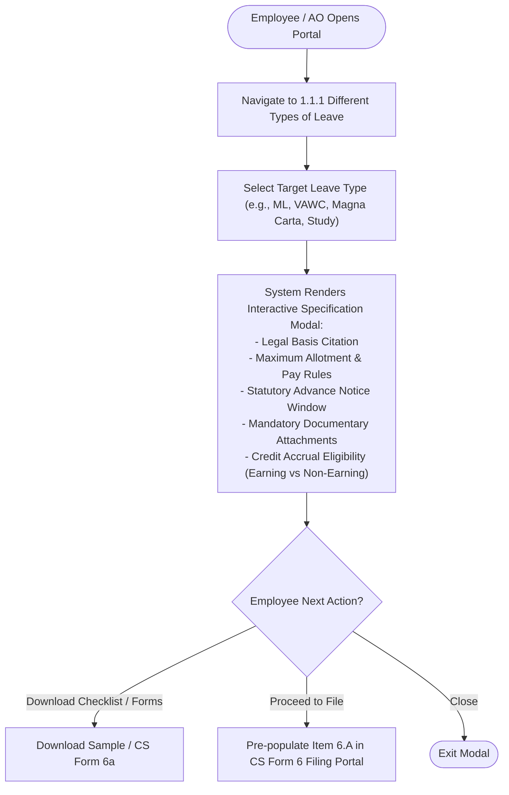

---

### Process 2: Actual Leave Credits Dashboard (Single-Pane View)
*   **System Box:** `1.1.2`, `1.1.2.1` to `1.1.2.4`
*   **Trigger:** User accesses dashboard to check current balances prior to filing leave or conducting monthly audit.
*   **Actors:** Employee (Self), Admin Officer (Dept View), HR Admin (Global View).

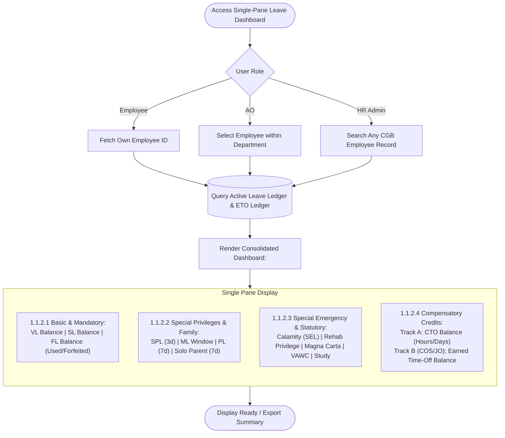

---

### Process 3: Standard Monthly Accrual & LWOP Proration Engine
*   **System Box:** `1.1.2.5.1 (Automated)` & `1.3.2**`**
*   **Trigger:** Automated cron trigger at 23:59 on the last calendar day of each month.
*   **Actors:** Automated System Engine, HR Admin (Auditor).

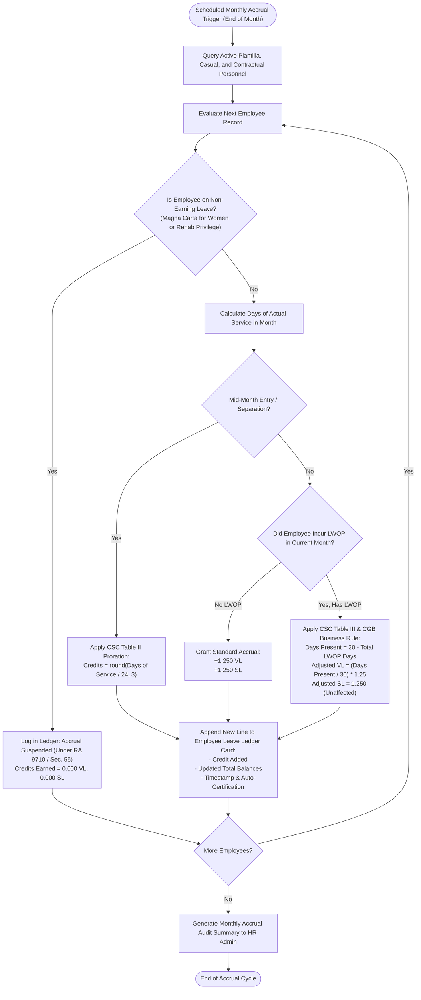

---

### Process 4: Conditional Statutory Lifecycle Crediting
*   **System Box:** `1.1.2.5.1 (Automated)` & `1.2.2.2`
*   **Trigger:** City Mayor / Vice Mayor approves statutory application (Maternity, Paternity, Magna Carta, Solo Parent).
*   **Actors:** Approving Authority, System Engine, Employee.

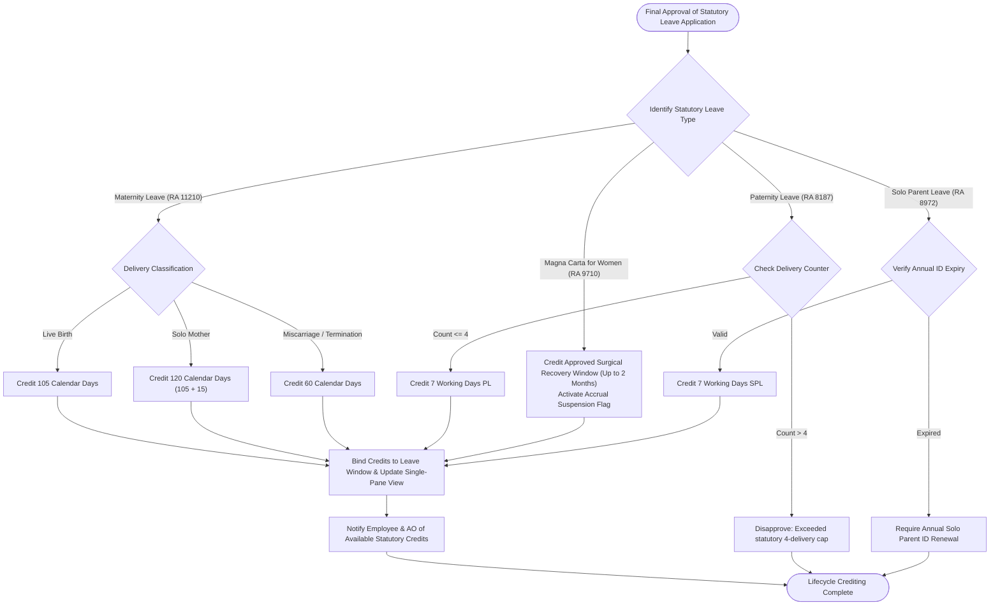

---

### Process 5: Batch Calamity Leave Crediting (Special Emergency Leave - SEL)
*   **System Box:** `1.1.2.5.1 (Manual Form)`
*   **Trigger:** Official declaration of State of Calamity by City Mayor, Sangguniang Panlungsod, or NDRRMC.
*   **Actors:** HR Admin, City Mayor / Sangguniang Panlungsod, Department AO.

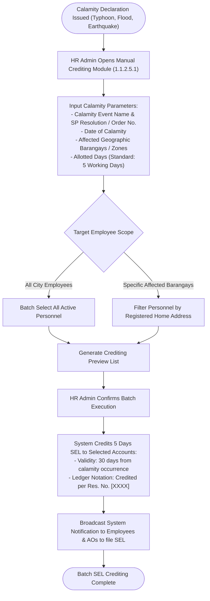

---

### Process 6: Leave Application Submission & Validation (CS Form No. 6)
*   **System Box:** `1.2.1`, `1.2.2`, `1.2.2.1`
*   **Trigger:** Employee initiates a leave request.
*   **Actors:** Employee (Applicant), System Validation Engine.

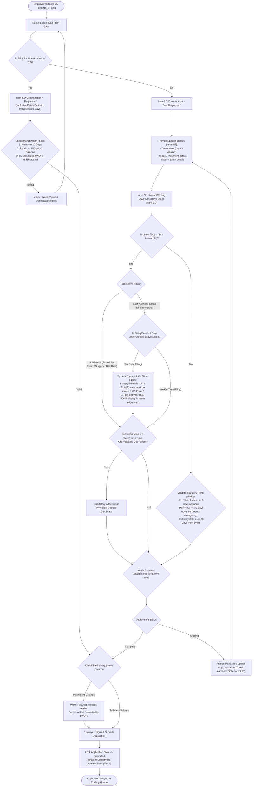

---

### Process 7: 5-Tier Review, Certification & Approval Workflow
*   **System Box:** `1.2.2.2`
*   **Trigger:** Successful submission of CS Form No. 6.
*   **Actors:** Employee, Admin Officer (AO), Department Head, CHRMO Head, City Mayor / Vice Mayor / Alternate Signatory.

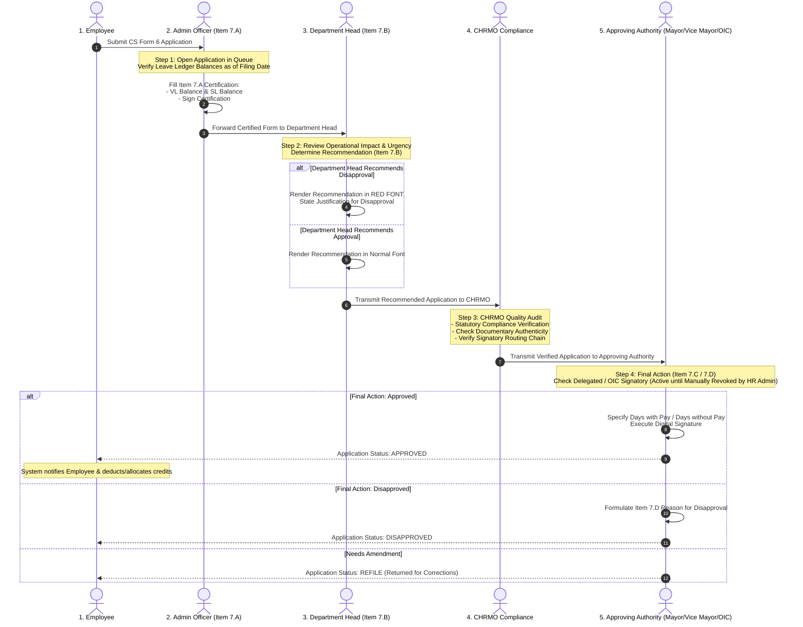

---

### Process 8: Leave Monetization Lifecycle
*   **System Box:** `1.2.2` & Section 6.4
*   **Trigger:** Employee requests monetization during official monetization window.
*   **Actors:** Employee, Department AO, CHRMO, City Mayor.

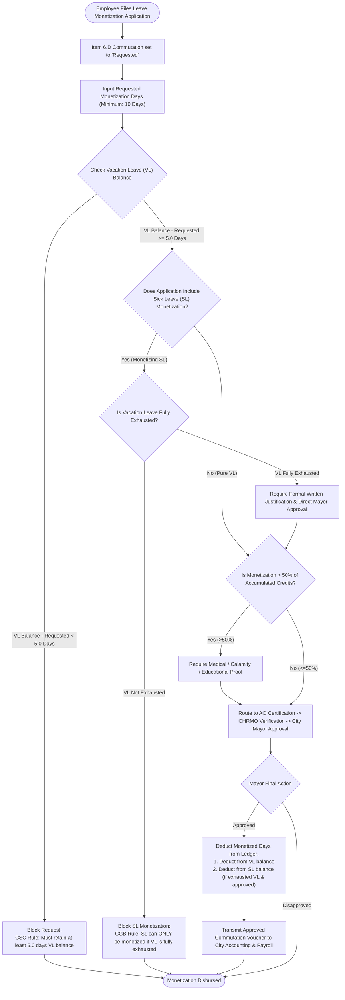

---

### Process 9: Terminal Leave Benefit (TLB) Processing
*   **System Box:** `1.2.2` & Section 7
*   **Trigger:** Employee separation from government service (Retirement, Resignation, Death).
*   **Actors:** Retiring/Separating Employee, CHRMO Records Officer, City Mayor, City Accounting.

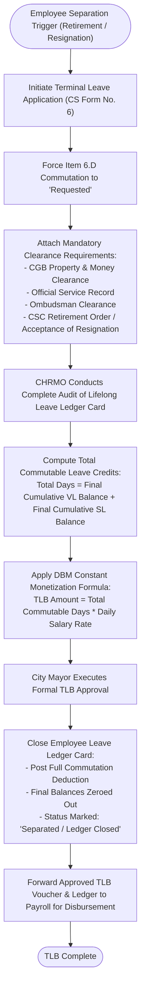

---

### Process 10: Approved Leave Recall & Restoration Process (VL & FL Only)
*   **System Box:** `1.2.3` & `1.2.3.1`
*   **Trigger:** Unforeseen operational exigency requiring an employee on Vacation or Forced Leave to return to duty.
*   **Actors:** Department Head, City Mayor, HR Admin, Employee.

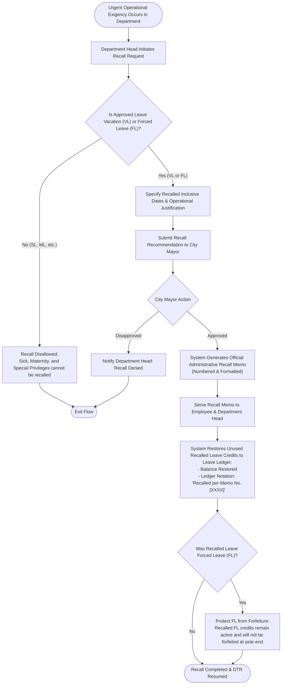

---

### Process 11: Approved Leave Cancellation & Rescheduling
*   **System Box:** `1.2.3` & `1.2.3.1`
*   **Trigger:** Employee requests cancellation or date modification of an approved leave.
*   **Actors:** Employee, Department Head, HR Admin.

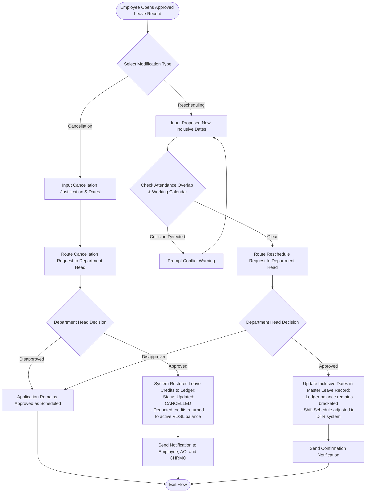

---

### Process 12: Automatic Holiday Collision & Restoration Rule
*   **System Box:** `1.2.3` & Section 6.4
*   **Trigger:** Declaration of a local or national non-working holiday that falls on dates of already-approved leave.
*   **Actors:** HR Admin (Declares Holiday in Calendar), Automated Leave Engine, DTR System.

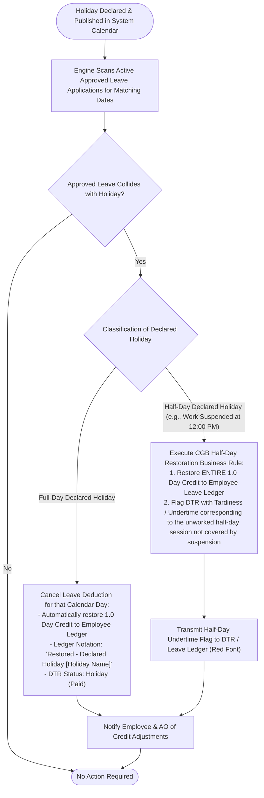

---

### Process 13: Leave Ledger Maintenance, Tardiness Deduction & Manual Override
*   **System Box:** `1.3.1` & `1.3.2`
*   **Trigger:** Monthly DTR consolidation or manual administrative adjustment.
*   **Actors:** HR Admin (CHRMO), Department AO (Viewer), Employee (Viewer).

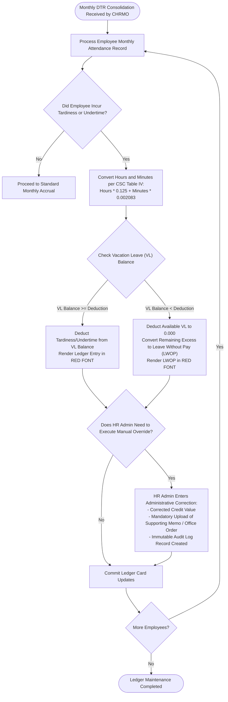

---

### Process 14: Compensatory Overtime Credits (COC/CTO) Lifecycle (Plantilla / Casual)
*   **System Box:** `1.3.3` (Track A)
*   **Trigger:** Completion of authorized overtime work under CSC-DBM Joint Circular No. 1, s. 2006.
*   **Actors:** Employee, Department Head, CHRMO.

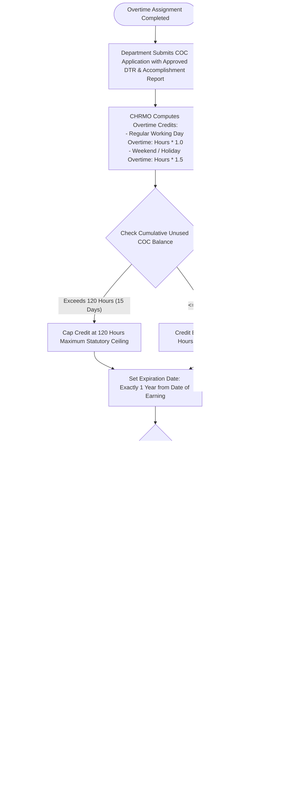

---

### Process 15: Overtime & Time Offset (TO) Lifecycle (Non-Govt: COS / JO)
*   **System Box:** `1.3.3` (Track B)
*   **Trigger:** COS/JO personnel rendering authorized overtime for urgent municipal projects.
*   **Actors:** COS/JO Personnel, Project Supervisor, Department Head, CHRMO.

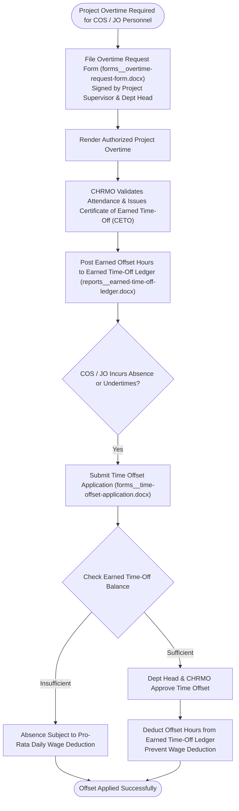

---

### Process 16: Regulatory Compliance Reporting (MRATU & SRATU)
*   **System Box:** `1.4.1`
*   **Trigger:** Monthly payroll cutoff and HR compliance calendar.
*   **Actors:** Department Admin Officer, Department Head, CHRMO, City Accounting/Payroll.

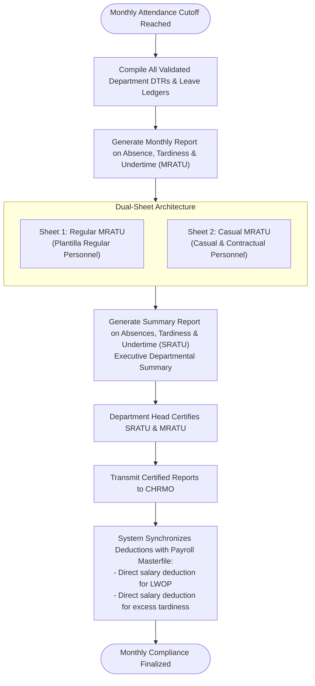

---

### Process 17: Official HR Certifications Issuance
*   **System Box:** `1.4.2`
*   **Trigger:** Request by active or separated employee for official certification of credits.
*   **Actors:** Requesting Employee, Records Officer, CHRMO Head.

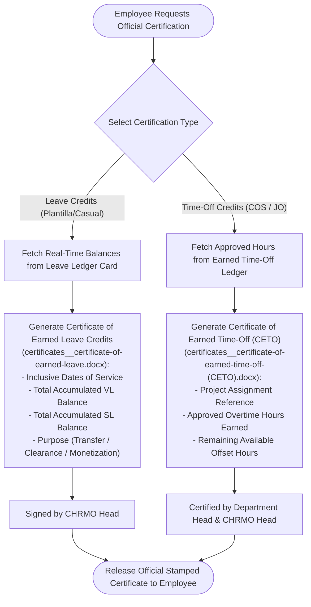

---

### Process 18: Operational Schedules & DTR Rectification Management
*   **System Box:** `1.4.3`
*   **Trigger:** Monthly shift scheduling or biometric device recording failure.
*   **Actors:** Department AO, Employee, Department Head, CHRMO.

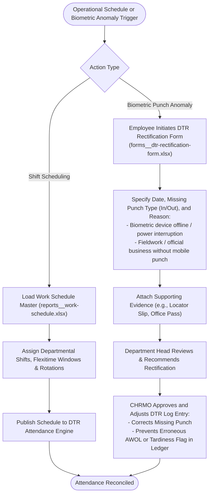

---

### Process 19: Downstream Integration — Notice of Step Increment (NOSI) Postponement
*   **System Section:** `Section 6.1`
*   **Trigger:** Posting of Leave Without Pay (LWOP) into Employee Leave Ledger.
*   **Actors:** Automated Engine, HR Compensation & Benefits Section.

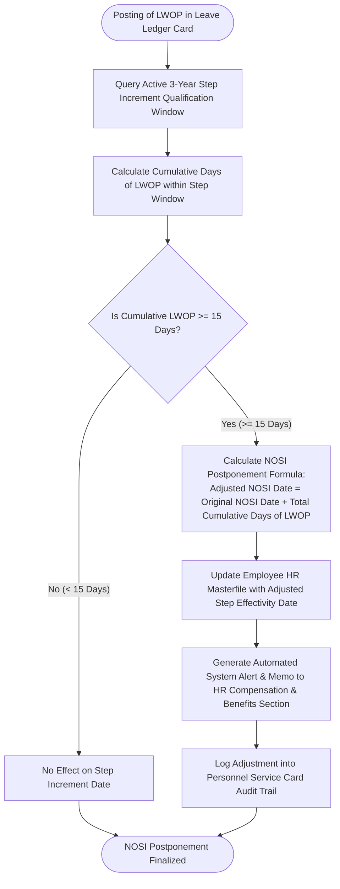

---

### Process 20: Downstream Integration — 20-Day AWOL Detection & Dropping from Rolls Alert
*   **System Section:** `Section 6.2`
*   **Trigger:** Real-time logging of unauthorized absence in daily attendance.
*   **Actors:** Automated System Monitor, HR Admin, City Mayor.

```mermaid
flowchart TD
    Start(["Daily Attendance Processing Cycle"]) --> DetectUnauthorized["Identify Unauthorized Absence (No Approved Leave on Record)"]
    DetectUnauthorized --> AccumulateMonth["Calculate Total Cumulative AWOL Days in Current Calendar Month"]

    AccumulateMonth --> CheckAWOLThreshold{"Has Employee Accumulated >= 20 Days AWOL in Month?"}
    CheckAWOLThreshold -->|"No (< 20 Days)"| FlagDTR["Flag Attendance as Unauthorized Absence in DTR & Ledger"] --> End(["Normal Exception Processing"])
    CheckAWOLThreshold -->|"Yes (>= 20 Days AWOL)"| TriggerCriticalAlert["Trigger CRITICAL HIGH-PRIORITY SYSTEM ALERT to HR Admin"]

    TriggerCriticalAlert --> AutoDraftNotice["System Automatically Generates Official Documents:<br/>1. Return-to-Work Order / Show Cause Notice<br/>2. Draft Notice of Dropping from the Rolls (CSC Omnibus Rules Sec. 63)"]
    AutoDraftNotice --> AdminServe["HR Admin Reviews and Serves Notice to Employee's Registered Address"]
    AdminServe --> StartCountdown["System Initiates Statutory 5-Day Written Explanation Timer"]
    StartCountdown --> DropEvaluation{"Written Explanation Received within 5 Days?"}
    DropEvaluation -->|"Valid Justification Accepted"| ResolveAbsence["Convert Absence to Appropriate Leave Category"] --> End
    DropEvaluation -->|"No Reply or Unjustified"| SubmitMayorDrop["Transmits Recommendation for Dropping from the Rolls to City Mayor"] --> End(["Administrative Dropping Initiated"])
```

---

## 4. Verification and Cross-Reference Matrix

| System Flow v5 Box ID | Box Label | Mapped Process ID | Key Legal / Template Artifact |
| :--- | :--- | :--- | :--- |
| **1.1.1 & 1.1.1.1** | Different Types of Leave & Requirements | **Process 1** | CS Form No. 6 (Item 6.A/6.B), Omnibus Rules |
| **1.1.2.1 - 1.1.2.4** | Actual Leave Credits (Single Pane View) | **Process 2** | `reports__leave-ledger.xlsx`, Single-Pane UI |
| **1.1.2.5.1 (Auto)** | Automated Leave Crediting | **Process 3, 4** | CSC Tables I–III, RA 11210, RA 9710 |
| **1.1.2.5.1 (Manual)**| Manual Calamity Leave Crediting | **Process 5** | CSC MC 16, s. 2012, Calamity Declaration |
| **1.2.1 & 1.2.2.1** | Input Leave Details & Late Filing | **Process 6** | `forms__application-for-leave-form.xlsx` |
| **1.2.2.2** | Compliance & 5-Tier Approval Chain | **Process 7** | CS Form 6 (Item 7.A–7.D), CGB Delegation Orders |
| **1.2.2 (Commutation)**| Monetization & Terminal Leave Benefit | **Process 8, 9** | DBM BC 2016-2, Clearance Form |
| **1.2.3 & 1.2.3.1** | Modification of Approved Leave | **Process 10, 11, 12** | Admin Recall Memo, Holiday Restoration Engine |
| **1.3.1 & 1.3.2** | Leave Credits & Ledger Management | **Process 13** | `reports__leave-ledger.xlsx`, CSC Table IV |
| **1.3.3 (Track A)** | Compensatory Overtime Credits (COC/CTO) | **Process 14** | `forms__compensatory-time-off.docx`, CSC-DBM JC 1 |
| **1.3.3 (Track B)** | Earned Time-Off (ETO) for COS/JO | **Process 15** | `certificates__certificate-of-earned-time-off-(CETO).docx`, `reports__earned-time-off-ledger.docx` |
| **1.4.1** | Regulatory Compliance Reports | **Process 16** | `reports__monthly-report-on-absence-tardiness-undertime-(MRATU).xlsx`, `reports__summary-report-on-absences-tardiness-undertime-(SRATU).docx` |
| **1.4.2** | Official HR Certifications | **Process 17** | `certificates__certificate-of-earned-leave.docx`, CETO |
| **1.4.3** | Operational Schedules & Rectification | **Process 18** | `reports__work-schedule.xlsx`, `forms__dtr-rectification-form.xlsx` |
| **Integration 6.1** | Step Increment Postponement | **Process 19** | CSC-DBM JC on NOSI, Service Record Sync |
| **Integration 6.2** | 20-Day AWOL Automated Alert | **Process 20** | CSC MC 13, s. 2007, Dropping from the Rolls Notice |
